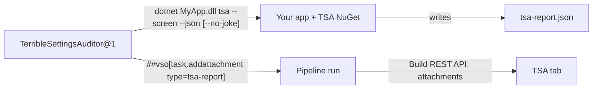

# TSA Azure DevOps Extension

An Azure DevOps extension for Terrible Settings Auditor (TSA). It has two parts:

1. **`TerribleSettingsAuditor@1` pipeline task.** It runs your app with `tsa --screen --json`, reads the `tsa-report.json` the app writes, and attaches it to the run.
2. **TSA build results tab.** It shows up on any run that used the task, after the built-in tabs (*Summary*, *Tests*, *Code Coverage*), and renders the attached report.



## Layout

| Path | What it is |
|---|---|
| `vss-extension.json` | Extension manifest: the task contribution and the `ms.vss-build-web.build-results-tab` contribution |
| `src/task/index.ts` | Task logic. esbuild bundles it into `tasks/TsaScreen/index.js` |
| `src/tab/` | Tab UI (`tab.ts`, `render.ts`, `tab.html`, `tab.css`). esbuild bundles it into `dist/tab/` |
| `src/shared/report.ts` | `tsa-report.json` types and parsing, shared by the task and the tab |
| `tasks/TsaScreen/` | Task folder that ships in the VSIX: `task.json`, icon, runtime `node_modules` |
| `samples/` | Example pipeline YAML and an example `tsa-report.json` |

## Build and package

```bash
npm install
npm run package
```

`npm run package` type-checks, bundles the task and the tab, installs the task's runtime dependencies, and writes `out/<publisher>.terrible-settings-auditor-<version>.vsix`. Use `npm run package:dev` to also bump the extension's patch version.

## Publish and install

1. Create a Marketplace publisher at <https://marketplace.visualstudio.com/manage>. If its ID isn't `mrjamiebowman`, change `publisher` in `vss-extension.json`.
2. Upload the `.vsix`. Keep `"public": false` to share it privately with your organization, or set it to `true` to list it publicly.
3. Install it into the organization (**Organization settings → Extensions**).

To publish from the CLI instead: `npx tfx extension publish --vsix out/<file>.vsix --share-with <org> --token <PAT>`.

**Shipping an update:** bump `version` in `vss-extension.json`, and also bump `version` in `tasks/TsaScreen/task.json` whenever the task changes. Agents cache tasks by version, so they won't pick up a changed task without a new task version.

## Pipeline usage

```yaml
- task: TerribleSettingsAuditor@1
  inputs:
    path: $(Build.ArtifactStagingDirectory)/app/MyApp.dll
    noJoke: true
```

See [samples/azure-pipelines.yml](samples/azure-pipelines.yml) for every input, and [overview.md](overview.md) for the input reference that appears on the Marketplace page.

How the task runs your app:

- A path ending in `.dll` runs as `dotnet <dll> tsa --screen --json`. Any other path (`.exe`, Linux apphost) runs directly.
- The app runs from its own directory unless you set `workingDirectory`. ASP.NET Core resolves `appsettings*.json` from the content root, which defaults to the current directory.
- A stale `tsa-report.json` is deleted before the run. After the run, the task looks for the report in the working directory, then in the app's directory.
- The task never passes `--no-abort`. With that flag, TSA keeps going and the web host starts, so the step would hang until the timeout.
- When the report is missing, or the app exits non-zero with a passing report, the step fails.

## The `tsa-report.json` contract

The tab parses the serialized `ScreeningReport` model and reads keys case-insensitively, so both PascalCase and camelCase output work:

```jsonc
{
  "Pass": false,
  "Configuration": [
    {
      "Name": "DatabaseConfiguration", "Namespace": "MyApp.Configuration",
      "Passed": false, "Pinned": false, "Order": 1, "Message": null,
      "Properties": [
        { "Name": "ConnectionString", "Description": "…", "Pass": false, "Message": "The ConnectionString field is required.",
          "Required": true, "Secret": true, "Expose": false, "ExposeValue": null, "Reason": null }
      ]
    }
  ]
}
```

The TerribleSettingsAuditor package writes this file with `tsa --screen --json` (see `Helpers/JsonReport.cs`). `ExposeValue` is masked the same way it is in the console report, and the tab shows it as-is.

## Previewing the tab locally

You can open the built tab outside Azure DevOps as a standalone `tsa-report.json` viewer:

```bash
npx http-server dist/tab -p 5180
```

Open `http://localhost:5180/tab.html` and pick a report file. Or copy a report into `dist/tab` and open `tab.html?report=<file>.json`.
